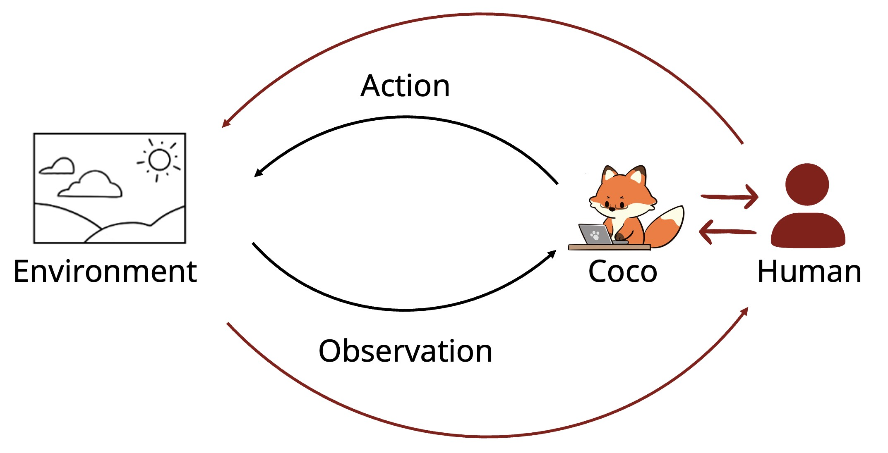

<p align="center">
  
</p>

**A minimal collaborative agent you can read end to end**

A lightweight desktop agent for learning, building, and experimenting with **human–agent collaboration**. It provides:

1. **Two collaboration primitives.** The agent can *send the user a message* and *wait for the user to continue* ([Primitives](#1-two-primitives-from-co-gym)).
2. **Two interfaces.** A desktop GUI (an avatar and a chat window) and voice (push-to-talk and a "Hey Coco" wake word) ([Interfaces](#2-interfaces-gui-and-voice)).

> If you want to see how an agent can stay aware of what the user is doing and personalize its help (screen sensing, proactive suggestions, long-term memory), see the full Coco repo: **https://github.com/collaborative-agents/coco**.

## Quickstart

```bash
# 1. Clone
git clone https://github.com/shaoyijia/mini-collaborative-agent.git
cd mini-collaborative-agent

# 2. Install packages for the Python service
uv sync

# 3. Launch the desktop app
cd desktop
npm install
npm start
```

## How it's put together

The system consists of two components:

1. Desktop app (`desktop/`): An Electron application providing the avatar, chat, voice controls, and agent execution through the [pi SDK](https://github.com/earendil-works/pi). The agent supports reading, writing, editing files, and running shell commands.
2. Tutor service (lib/proactive_tutor/): A local FastAPI service handling model requests, conversation context, audio transcription, and wake-word detection.

The components communicate over authenticated local HTTP.

## 1. Two primitives for Human-Agent Collaboration

[Collaborative Gym (Co-Gym)](https://github.com/SALT-NLP/collaborative-gym) ([paper](https://arxiv.org/abs/2412.15701)) models human–agent collaboration by giving the agent two actions beyond its task tools: **`SendTeammateMessage`**, which talks to the human, and **`WaitTeammateContinue`**, which hands control back to the human. This repo implements both.

### Send the user a message

The agent sends the user a message in two ways:

- **Its reply text.** Every turn streams Markdown into the chat as the model writes it.
- **The `ask_user_question` tool.** We turn on the [`rpiv-ask-user-question`](https://www.npmjs.com/package/@juicesharp/rpiv-ask-user-question) pi plugin, so the agent can stop mid-task and ask one or more structured questions (multiple-choice, multi-select, or free text). The run is suspended until the user answers.

### Wait for the user to continue

When the agent finishes replying, its turn ends and control goes back to the user.

The user also has these controls during and after a run:

- **Stop** aborts the run in progress. Completed file changes are kept, and the agent is told never to claim stopped work was finished.
- **Reply-ready reminder.** If the chat window is out of view, the avatar shows short progress notes while the run continues and a "Reply ready" bubble when it ends (`AgentProgressReminder`, `agent-reply-ready`).
- **Resume.** Every conversation is saved locally and can be reopened and continued later.

**This version cannot sense user activity.** If you want the agent to be aware of the user activity, derive useful user memory from computer use, and decide on its own when to step back in and can personalize its help, we need to add additional module to achieve this. See [collaborative-agents/coco](https://github.com/collaborative-agents/coco) for that design.

## 2. Interfaces: GUI and voice

### GUI

- **Avatar:** Always-on-top companion displaying agent progress and notifications.
- **Chat:** Streaming responses, tool activity, working-folder selection, model switching, and conversation history.
- **Shortcut:** Cmd/Ctrl + Shift + Space to open chat.

### Voice

- **Push-to-talk:** Speak directly through the chat interface.
- **Wake word:** Optionally activate the agent with "Coco", "Hi Coco", or "Hey Coco". Wake-word detection runs locally.

## Driving Coco from a script

Simulation is a common approach in studying human-agent collaboration. Coco supports using a user simulator to play the user through a local driver by starting the app with `COCO_DRIVER=1 npm start` to enable it. The app then writes the driver's URL and a token to `driver.json` in its data folder (owner-only), and accepts:

- `POST /sessions {"opener": ...}` starts a new chat with that first message and returns its `sessionId`.
- `POST /sessions/<id>/messages {"text": ...}` sends a message, exactly as if it were typed.
- `POST /sessions/<id>/answers {"toolCallId": ..., "answers": [...]}` answers an open question card, one free-text answer per question (`null` skips it).

See [desktop/src/main/chat-driver.ts](desktop/src/main/chat-driver.ts) for details.

## Data & privacy

There is no telemetry and no Coco server. The only data that leaves your machine is what you send to the model provider you configure. See [PRIVACY.md](PRIVACY.md) for the details. The default path for local data storage is as follows:

- **macOS**: `~/Library/Application Support/coco`
- **Windows**: `%APPDATA%\coco`
- **Linux**: `$XDG_CONFIG_HOME/coco` or `~/.config/coco`

## Acknowledgement

This repo is derived from [Coco](https://github.com/collaborative-agents/coco). We thank Long Lin for designing the avatar. The execution agent builds on [pi](https://github.com/earendil-works/pi), an excellent open-source agent harness. The collaboration primitives follow [Collaborative Gym](https://github.com/SALT-NLP/collaborative-gym).

## Citation

If you use this code, please cite Coco and Co-Gym:

```bibtex
@software{coco2026,
  title        = {Coco: Proactive Co-Assistant Through Continuous Context Observation},
  author       = {Shao, Yijia and Wang, Yihan and Wang, Haowen and Yang, Diyi},
  year         = {2026},
  url          = {https://github.com/collaborative-agents/coco}
}

@article{shao2024collaborative,
  title   = {Collaborative Gym: A Framework for Enabling and Evaluating Human-Agent Collaboration},
  author  = {Shao, Yijia and Samuel, Vinay and Jiang, Yucheng and Yang, John and Yang, Diyi},
  journal = {arXiv preprint arXiv:2412.15701},
  year    = {2024}
}
```

## License

Apache License 2.0. See [LICENSE](LICENSE).
